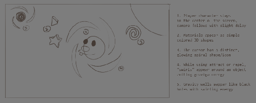

<!-- Snapshot of the Rubbley GDD exported from Google Docs on 2026-10-21.
     Source of truth: https://docs.google.com/document/d/13WdZPu5QuGl71A4ymnE3wbceHjoKEd8jd4Y91OnHyO0/edit
     Re-export with: curl -L "https://docs.google.com/document/d/13WdZPu5QuGl71A4ymnE3wbceHjoKEd8jd4Y91OnHyO0/export?format=md" -->

# Rubbley

## 2.5D Physics Action-Puzzle Game

# **DESCRIPTION**

Rubbley is a top-down action game with an overhead-angle follow camera with simple controls \- pinch in to attract, pinch out to repel, swipe to spin. The game plays similarly to a space shooter such as Asteroids but the player is always in the center of the screen and the level scrolls about them.

Rubbley’s powers come from a mysterious crystal called Gravega that was bestowed upon him by a shadowy figure within a black hole. The power of the Crystal helps him escape, and the Crystal speaks to him, telling him to seek more Gravega.

Debris and elements that Rubbley collects will be stored in a “merge grid” that lets players merge elements into power ups to improve gameplay. This is how Rubbley gains new powers and experience.

Divided into levels selectable from a menu styled to match Rubbley’s journey, like 2 Dots, or Candy Crush. There are distinct "Worlds" or "Areas" with their own styles and color palettes.

Players traverse levels using the Gravega powers to move around, collect debris and power ups, avoid obstacles, and defeat enemies.

# **NARRATIVE**

The game starts with Rubbley in a *Record Scratch* "Well, I bet you're wondering how I ended up in this situation" where he's being pulled beyond the event horizon of a black hole and about to disintegrate when a voice calls to him from inside, and he lets go to be sucked within, where he is introduced to the Gravega Crystal that gives him the gravity powers to escape.

The events leading up to the black hole involves him being in the wrong place at the wrong time, a bystander hurt by the ruthless desperate search by the "EVIL ONE" to find the Gravega Crystal.

After Rubbley escapes, EVIL ONE chases him through the galaxy, attempting to steal the Gravega Crystal for themselves.

# **GAMEPLAY**

Rubbley plays out in a 2.5D top-down view, where the player is able to traverse the world, avoid obstacles, and attack foes by manipulating gravity using the power of the Gravega Crystal. The game is designed for touch input first, but will also have a control scheme that works for both M+KB & Controller as well.

Players compete for high scores within a level, gaining points for growing Rubbley's mass, collecting resources within the level, and defeating enemies.

## **Resources**

In Rubbley, players manage two kinds of resources: mass, and stamina. 

**Mass** determines Rubbley’s capability to take damage, from collisions or enemy projectiles or other hazards. Additionally, mass determines how Rubbley’s Gravega powers interact with other celestial bodies. When Rubbley has more mass, the Gravega draws and repels the body from Rubbley as the center point. When the other body has more mass, Rubbley is drawn to and repelled from the other body as the center point.

**Stamina** determines the amount of time Rubbley can maintain the actions of his moveset. While in use stamina drains until it is empty or the player stops using the action. Stamina regenerates at a set rate while not in use.

**Materials** are collected by the player during gameplay \- they are collectibles in "trails" around the map, and also are dropped by various enemies. Rubbley can collect them by drawing them in with Gravega. Materials are used outside of stages in order to fuel the progression system in the game.

## **Moveset**

Rubbley has three actions available to players, attract, repel and spin. All three of these actions require stamina to maintain.

### **Attract**

Attract causes Rubbley to place a gravity well in space, or use a special Gravega power to increase an entity's gravitational pull. All uses of Attract use the "pinch" gesture to activate.

If Attract is used on anything other than Rubbley or a glowing celestial body, Rubbley will place a gravity well at the center of the "pinch" gesture. The gravity well will last for a certain amount of time, based on Rubbley's stats. This use of attract will consume one-half of Rubbley's current stamina, so it is possible for Rubbley to place two gravity wells in quick succession, if needed.

While using Attract targeting himself, debris will not damage him but instead be absorbed and increase his size. Additionally using Attract will continuously drain stamina. Attract can also be used to influence the position of enemies around Rubbley, provided his gravitational pull is strong enough to affect them. This use of Attract requires pinching and holding on Rubbley to activate.

Additionally, Attract can also be used on other celestial bodies, increasing their gravitational force on Rubbley and drawing him into their orbit. This use of Attract requires pinching and holding on the celestial body in question. Eligible bodies for this action will be highlighted in a glow. This use of Attract consumes stamina at a lower rate.

### **Repel**

Repel causes Rubbley to push objects away from him, using his special Gravega power to reverse his gravitational force. When Repel targets a celestial body, it gives a one-shot push that sends Rubbley away from it, allowing him to influence his trajectory as he moves through space.

Repel can also be used to send out a pulse of gravitational force that stuns enemies, by using the pinch-out gesture on Rubbley himself.

Using the pinch-out gesture on empty space sends out a Gravity Ripple instead: a push outward from that point that moves Rubbley too, but doesn't stun.

All three uses of Repel consume a set amount of stamina.

### **Spin**

Spin will generate a short term deflector shield to deflect objects. Spin is activated by swiping in any direction on the screen. Spinning will generate a shield all the way around Rubbley that deflects objects from every angle, so Spin is about timing rather than aiming. Spin at the perfect moment and projectiles will be blasted back at whoever fired them. While spinning, Rubbley is impervious to collision damage. Using Spin drains a set amount of Stamina.

## **Controls**

Rubbley has a flexible control scheme that works in a fun-to-play manner on any form factor, including controller, mouse \+ keyboard, or touch.

### **Controller**

When playing with a controller, the trigger buttons are used to activate Attract and Repel, while an aim cursor moved with the left analog stick determines what Rubbley is "aiming" at. Additionally, the camera can be "nudged" using the right analog stick. Spin is activated by pressing any face button. The aim cursor sits around Rubbley in the direction the left stick points and snaps to nearby glowing bodies. R1/RB cycles between nearby targets, and leaving the stick at rest aims at Rubbley himself.

### **Mouse \+ Keyboard**

When playing with mouse and keyboard, left and right click are used to activate Attract and Repel, while the mouse position moves the secondary cursor to determine what Rubbley is "aiming" at. The camera can be nudged with WASD. Spin is activated by pressing spacebar.

### **Touch**

When playing with touch, a "pinch-in" and "pinch-out" gesture is used to activate Attract and Repel, while the center of the pinch determines what Rubbley is "aiming" at. Additionally, the camera can be "nudged" using multi-touch drag. Spin is activated by swiping anywhere on the screen.

### **Camera**

Phones play in portrait and desktop in landscape. Rubbley stays centered with a soft follow that can be tuned down to a hard lock. The camera zooms out as Rubbley grows, and Camera Zones can widen the view. A camera nudge is a short peek that springs back when released.

## **Advancement**

Advancement involves upgrading several aspects of Rubbley’s abilities, increasing his health. Increasing his spin stamina, increasing his gravitational pull, and other improvements like spikes, and even special attacks.

Additionally, consumable items and power-ups can be applied to help a player advance through levels that they are struggling with. These can be collected during gameplay or offered as rewards for progressing through levels.

# **LEVELS**

## **Overview and Goals**

Levels are different sectors of space. The game offers a Candy Crush style world map, with linear level advancement. Each level offers unique backgrounds and environments, and Rubbley travels automatically through a stage. The player attempts to achieve high scores by increasing Rubbley’s size and also building a multiplier by attacking enemies and collecting power-ups. Attracting debris is one way to achieve this, but also deflecting enemy attacks will protect his size. Each level will end by totaling the player’s score, and high scores will be displayed on an online leaderboard

## **Brainstorming**

### **Open World vs Discrete Levels**

Discussion on an open world style design vs discrete levels

### **"Metroidvania" Progression**

Level progression could be governed by required mass to perform progression tasks, for instance, or by Gravega crystals unlocking more of the moveset. For instance, start with only Attract, gain Repel and Spin, or maybe add even more mechanics and moves to Attract, Repel, or Spin.

### **Procedural Progression**

Level progression could require exploring the map to find the "entrance" to the next level, with the player able to freely traverse between levels in gameplay in order to explore old areas with new abilities and collect missed items.

### **Orbital Traversal**

Levels could be crossed by orbiting very large, heavy celestial bodies that barely move. Rubbley falls into a body's orbit (a slow approach is helped into a steady circle), uses Repel on it to slingshot out with momentum toward the next one, and uses Attract on a distant body to pull himself in. Timing the slingshot sets the direction and speed Rubbley leaves with, so chaining orbits becomes a traversal skill.

# **VISUALS**

Cartoony, whimsical, and celestial bodies are anthropomorphic. All characters are either cosmic beings or sentient celestial bodies.

## **Concept Art**

TO DO

## **Art References**

### **The Amazing World of Gumball**

* Simple, flat art style  
* Expressive, animated characters within a realistic world

### **Cory Carson**

* Animated faces on 3D objects  
* Simple, inviting color palette

### **“Space Anime”**

### 

### **No Man’s Sky**

### **Anthropomorphic Planets**
